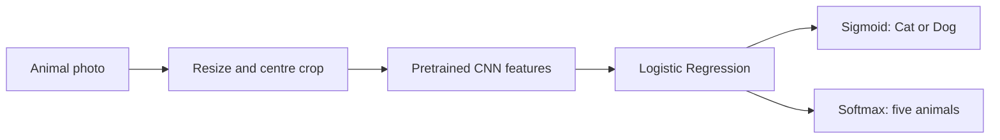

# Animal Classifier

Classify photos of cats, dogs, cows, horses and sheep. The project starts with Logistic Regression on raw pixels, then tests how much better it works with features from a pretrained CNN. A small CNN and a transfer-learning model provide comparisons.

[Try the live Animal Classifier](https://animalxclassifier.streamlit.app/)

## How it works

Binary Logistic Regression uses Sigmoid to estimate the probability that a photo shows a dog. At a probability of 0.5 or higher, it predicts Dog. The multiclass model learns one score per animal. Softmax turns the five scores into probabilities that add up to one.

The raw-pixel models used small, flattened images. They could learn patterns at fixed positions, but a change in pose or background could produce a very different input. Dogs also outnumbered cats, and the original binary model found only 8.03% of the cats in the test set. Adjusting class weights helped some classes without solving the problem with the input.

The improved models use **ImageNet-pretrained MobileNetV3-Small**. The frozen CNN represents each photo with 576 features. Logistic Regression learns which of those features help tell the animals apart. Cat recall rose to 95.98% on the same historical test set.



## Results

The original and improved models used the same historical Animals-10 test images. The binary split had 979 photos and the five-class split had 1,925. Macro-F1 gives each animal equal weight by averaging its F1 score.

| Model | Original accuracy | Improved accuracy | Original macro-F1 | Improved macro-F1 |
| --- | ---: | ---: | ---: | ---: |
| Binary Logistic Regression | 72.73% | 98.26% | 48.43% | 97.70% |
| Five-class Logistic Regression | 47.48% | **94.23%** | 39.01% | 93.54% |
| CNN comparison | 63.27% | 94.65% | 58.56% | 94.24% |


We had already inspected the historical test results before improving the models. After freezing the improved models, we tested them on a separate set of iNaturalist photos. The five-class Logistic Regression model scored **58.14%** on 86 external photos, and the transfer CNN scored 53.49% on the same photos. Binary Logistic Regression scored 64.86% on the 37 eligible cat and dog photos. This small sample included distant, dark and partly hidden animals. It shows why the historical score is a poor estimate for arbitrary phone photos.

See the [external sample manifest](outputs/improved/external_manifest.csv) and [experiment records](outputs/improved/) for selection details, validation scores and per-class results.

## Run the app locally

Use Python 3.12. This was tested on an Apple M3 MacBook Air with Python 3.12.13. From the repository folder:

```bash
python3.12 -m venv .venv
source .venv/bin/activate
python -m pip install -r web/requirements.txt
python -m streamlit run web/app.py
```

Open the address shown by Streamlit. Swipe through ten [licensed examples](web/assets/gallery/credits.json), upload a JPG, PNG or WEBP file, or take a photo with your camera. The five-animal model is selected by default. The app processes photos in memory and does not save them. Camera access needs permission and a secure address such as HTTPS or localhost. Results are probability estimates. The model always picks from its supported animals.

Streamlit runs the interface, Pillow and NumPy prepare the image, ONNX Runtime runs the frozen feature extractor, and scikit-learn runs Logistic Regression. The web app uses the saved models on CPU without the training dataset. See the [deployment notes](outputs/deployment_feasibility.md).

## Model sizes

| Saved artifact | Bytes | Size |
| --- | ---: | ---: |
| Original binary LR classifier | 46,152 | 45.07 KiB |
| Original five-class LR classifier | 72,117 | 70.43 KiB |
| Improved binary LR classifier and scaler | 16,351 | 15.97 KiB |
| Improved five-class LR classifier and scaler | 24,981 | 24.40 KiB |
| Frozen feature extractor in PyTorch format | 3,830,651 | 3.65 MiB |
| Frozen feature extractor in ONNX format | 3,717,004 | 3.54 MiB |
| Original small CNN weights | 361,413 | 352.94 KiB |
| Transfer CNN weights | 4,129,209 | 3.94 MiB |
| Web pipeline for five-class LR | 3,742,557 | 3.57 MiB |
| Web pipeline with both LR modes | 3,758,908 | 3.58 MiB |

The five-class classifier is 24.40 KiB on its own. The complete pipeline includes the ONNX extractor and preprocessing settings, so it is larger than the original small CNN's weights. These sizes exclude installed libraries, Python and the web interface.

On the Mac, the web libraries occupied 444.6 MiB. Standalone CPU inference took a median of 7.8 ms per example photo and peaked at about 231 MiB in memory after the ten examples. A synthetic 24-megapixel photo raised peak memory to about 503 MiB. These measurements exclude Streamlit's overhead. The ONNX model reproduced the predicted labels for all 2,904 historical cases. [Runtime measurements](outputs/web_runtime_profile.json) · [Inference checks](outputs/web_app_checks.json)

## Reproduce the experiments

The dataset is [Animals-10 by Alessio Corrado](https://www.kaggle.com/datasets/alessiocorrado99/animals10), version 2. The five selected folders yielded 12,839 usable photos after one confirmed label error was removed. Similar photos were grouped before splitting. The training, validation and test sets contain 8,986, 1,928 and 1,925 images. Dataset photos stay local. See the [dataset license record](outputs/dataset_license.md).

With the Python 3.12 virtual environment active, install the research requirements and download the dataset:

```bash
python -m pip install -r requirements.txt
mkdir -p data/raw data/processed
kaggle datasets download -d alessiocorrado99/animals10 -p data/raw --unzip
```

Open the [notebooks](notebooks/) in order. They cover data preparation, binary Logistic Regression, five-class Logistic Regression, and the CNN comparison. They reuse saved results by default.

```bash
python -m notebook notebooks
```

See the [reproduction steps](outputs/reproduce_study.md) for the notebook kernel, CLI demo, retraining commands and external verification. The original files and results are also available at Git tag `baseline-raw-pixels`.
