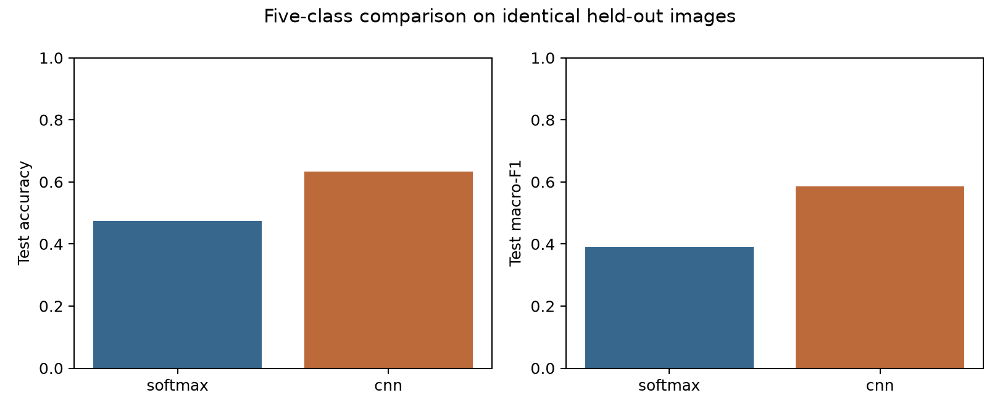

# Animal image classifier

A summer-training project by Himanshu Rajkhowa, B.Tech CSE, The Assam Royal Global University. It classifies photographs as Cat, Dog, Cow, Horse or Sheep and compares three approaches: binary Logistic Regression, five-class multinomial Logistic Regression and a small CNN.

This is an implementation for university evaluation based on learning through IBM SkillsBuild. Data Analysis with Python was completed; Supervised Learning Methods is ongoing. The university report is deferred until the logo and required format are supplied.

## Measured results

These are actual held-out results from the saved models, not the examples in the earlier presentation. Precision, recall and F1 below are macro averages.

| Model | Accuracy | Precision | Recall | F1 | Saved size | Training time |
| --- | ---: | ---: | ---: | ---: | ---: | ---: |
| binary | 72.73% | 0.548 | 0.514 | 0.484 | 0.044 MiB | 0.96 s |
| softmax | 47.48% | 0.426 | 0.384 | 0.390 | 0.069 MiB | 6.60 s |
| cnn | 63.27% | 0.611 | 0.575 | 0.586 | 0.345 MiB | 53.73 s |

The binary task has 979 test images; the five-class models use the same 1,925 test images. Binary accuracy is below the 74.57% always-Dog baseline. Cat recall is only 8.03%, so its accuracy hides weak Cat detection. Dog precision, recall and F1 are 0.751, 0.948 and 0.838. The five-class majority baseline is 37.92% accuracy.

The CNN improves five-class accuracy by 15.79 percentage points over Logistic Regression. This comparison also changes input resolution, from 24 × 24 to 64 × 64 pixels, so it does not isolate architecture alone. Logistic Regression timing includes all three-fold regularization searches and refitting; CNN timing includes training and validation for 20 epochs. The CNN saved epoch 19, selected by validation loss; its early-stopping patience was not exhausted.



Class-wise reports, confusion matrices, CV scores, learning curves, predictions and exact split IDs are in `outputs/`. Numerical results are preserved even where performance is weak.

## Prerequisites and setup

Tested on a MacBook Air with Apple M3, 8 GB RAM and macOS, using Python **3.12.13**. Use Python 3.12; Python 3.14 is not the tested environment. The dependency versions are pinned in `requirements.txt`. You need Python 3.12 with pip/venv, an internet connection for installation and the dataset, and a browser for the demo. Reserve roughly 3 GB of free disk space for data, dependencies and generated files. Training ran with Apple MPS acceleration; CPU training is supported but slower. No GPU package, API key or paid cloud service is required for the classifier.

From the existing project:

```bash
cd "$HOME/Desktop/animal classifier"
python3.12 -m venv .venv
source .venv/bin/activate
python -m pip install -r requirements.txt
```

If `.venv` already exists, activate it and use it; there is no need to recreate it. On this Mac it is already installed. A fresh download from GitHub uses the same steps inside the cloned repository.

The main libraries are:

| Library | Practical purpose |
| --- | --- |
| Pillow | Read images, apply EXIF orientation, convert to RGB and resize |
| NumPy | Store and normalize pixel arrays |
| pandas | Organize image labels, splits and result tables |
| Matplotlib | Plot sample images, distributions, confusion matrices and learning curves |
| scikit-learn | Logistic Regression, fold-specific scaling, group-aware splits and metrics |
| PyTorch | Define and train the CNN, using MPS when available |
| ImageHash | Find candidate near duplicates, including reflected versions |
| SciPy | Check sigmoid and Softmax probability calculations |
| joblib | Save and reload Logistic Regression pipelines |
| Kaggle | Download the original dataset through its official API client |
| Jupyter and nbclient | Read the notebooks and execute them in order |

## Dataset and preparation

Download [Animals-10 by Alessio Corrado](https://www.kaggle.com/datasets/alessiocorrado99/animals10), version 2, using the supported Kaggle client:

```bash
mkdir -p data/raw data/processed
kaggle datasets download -d alessiocorrado99/animals10 -p data/raw --unzip
```

The public download worked without credentials in this run. If Kaggle asks you to authenticate, use `kaggle auth login` or follow its official authentication instructions. Keep credentials outside this repository and never commit them.

The archive expands to `data/raw/raw-img/`. Its 26,179 images cover ten Italian labels. We map `gatto`, `cane`, `mucca`, `cavallo` and `pecora` to Cat, Dog, Cow, Horse and Sheep. There are 12,840 files in these folders. Full decoding found no corrupt images and no exact byte/pixel duplicates. Visual review excluded one wrongly labelled horse from the Cow folder, leaving **12,839 images**.

Perceptual hashes identify 1,108 candidate pairs. All detected related groups stay in one split, including uncertain matches. The target split is 70% training, 15% validation and 15% test, with seed 42 and stratified grouping. Actual counts are 8,986 / 1,928 / 1,925 because groups must stay intact. The split manifest and review decision are saved; no test score informed cleaning or model selection.

Kaggle lists GPL-2.0, but its description says images came from Google Images and supplies no individual image licenses. See [the source and license record](outputs/dataset_license.md). Images, resized arrays and image-bearing outputs stay local. The small fitted models, numerical records and image-free charts are included so saved inference can be inspected and reproduced.

## Run the notebooks

Run these four notebooks in order:

1. `01_Explore_and_Prepare_Animal_Images.ipynb`: source labels, integrity checks, duplicate groups, visual cleaning, EDA, fixed splits and pixel arrays.
2. `02_Cats_vs_Dogs_Binary_Logistic_Regression.ipynb`: Cat = 0, Dog = 1, logits, sigmoid, the 0.5 threshold, CV and real TP/TN/FP/FN examples.
3. `03_Five_Animals_Multinomial_Logistic_Regression.ipynb`: five class scores, Softmax, class-wise evaluation and probability plots.
4. `04_Five_Animals_Small_CNN.ipynb`: a small CNN, validation-based checkpoint selection, learning curves and the model comparison.

For an interactive session:

```bash
python -m ipykernel install --prefix .venv --name animal-classifier --display-name "Animal classifier Python"
JUPYTER_PATH="$PWD/.venv/share/jupyter" python -m notebook notebooks
```

Choose the Animal classifier Python kernel. Use Run All Cells in each notebook before moving to the next. Paths work from the project or `notebooks/` directory.

To execute the complete workflow without opening Jupyter:

```bash
python run_notebooks.py
python verify.py
```

This retrains the models and updates outputs. To resume after completed preparation and baseline notebooks, use `python run_notebooks.py --start 4`, for example. The local notebooks retain their real outputs. Published notebook copies have outputs cleared to avoid redistributing photographs; rerunning them fills the outputs again.

## How training and validation work

Both Logistic Regression models flatten normalized 24 × 24 RGB arrays. A scikit-learn Pipeline fits StandardScaler inside each training fold. Three StratifiedGroupKFold folds choose C from 0.0001, 0.001 and 0.01 using macro-F1 on training data only. The independent validation set measures generalization; the test set supplies the final metrics.

The CNN receives normalized 64 × 64 RGB arrays. It has three convolution blocks, two linear layers, dropout and 89,509 trainable parameters. Adam uses learning rate 0.001 and weight decay 0.0001, with a 20-epoch cap and patience of four. Validation loss chooses the checkpoint. No pretrained weights or test-set tuning are used.

Training/validation accuracy is 76.15%/72.91% for binary Logistic Regression, 58.34%/48.65% for five-class Logistic Regression, and 70.93%/62.97% for the selected CNN in evaluation mode. The five-class gaps support an overfitting concern; poor binary Cat recall also shows that raw pixels and imbalance limit the baseline. The CNN validation loss improved overall with some fluctuations, so there is no evidence of a persistent early-stopping plateau in this run.

## Local prediction demo

Saved models are included and do not require downloading the dataset for prediction. After installing dependencies:

```bash
python demo.py
```

Open [the local demo](http://127.0.0.1:8765), choose an image, select a model and click Predict animal. The page shows the label and all five estimated probabilities. Press Ctrl+C in the terminal to stop the server. The server listens only on this computer and processes uploads in memory without saving them.

You can also predict a file from the terminal:

```bash
python demo.py --image "/absolute/path/to/animal.jpg" --model cnn
```

A real held-out Dog image, ID `3e50b7a3bd28845fe91b`, was predicted as Dog with **76.6%** estimated probability by the CNN and **66.3%** by five-class Logistic Regression. This is one example, not an overall accuracy claim.

## Files and reproducibility

`data/` keeps raw images separate from processed arrays. `models/` stores three small fitted files and the preprocessing configuration. `outputs/` preserves the split manifest, metrics and figures; its ignored `private/` folder contains photographs and review contact sheets. `report/` is reserved for the later university report.

Only four Python helpers are shared: `common.py` keeps preprocessing and evaluation consistent, `demo.py` runs inference, `run_notebooks.py` executes notebooks and clears their outputs for Git, and `verify.py` checks split reproducibility, leakage, recorded metrics, selected-C CV scores and saved inference. `outputs/verification.json` records the checks and artifact hashes. All notebooks executed successfully, the selected-C CV scores were reproduced, and raw-image demo probabilities matched saved test predictions on 15 images per five-class model. CNN MPS training can vary slightly between runs; the saved weights preserve this run.

The useful `.gitattributes` rule clears notebook outputs on Git check-in while preserving executed local notebooks. To enable it after cloning, run:

```bash
git config filter.notebook-clean.clean '.venv/bin/python run_notebooks.py --strip'
git config filter.notebook-clean.required true
```

Datasets, `.venv`, caches, credentials and private figures are ignored. Agent skills are installed globally and are not part of the ML repository.

## Learning and limitations

The project applies data wrangling, EDA, supervised classification, reproducible splitting, cross-validation and model evaluation learned during summer training. It connects sigmoid and Softmax equations to numerical predictions and makes class imbalance visible through class-wise recall and macro-F1.

Performance is modest, especially for Cats and Cows. Labels were sample-reviewed, not fully re-annotated. A Horse photograph still labelled Dog was noticed after evaluation (ID `71c888b97f4ee9528f32`); it remains in the recorded test set, so scores are measured against imperfect dataset labels. Perceptual hashes can miss crops or related source images; source identities are unavailable. Square resizing distorts some images. Probabilities are uncalibrated, and an unrelated image is still assigned one of the five classes. This model has not been validated on a separate real-world collection. Model size alone does not measure hosting memory or dependency size.

No Vercel deployment was made and no account settings were changed. The [deployment feasibility note](outputs/deployment_feasibility.md) recommends reusing the Python preprocessing and CPU checkpoint first. Browser ONNX inference remains a possible future option after export and preprocessing-parity tests. The hackathon retains priority over any hosting experiments.

## References

- [Original Animals-10 dataset](https://www.kaggle.com/datasets/alessiocorrado99/animals10)
- [Official Kaggle CLI](https://github.com/Kaggle/kaggle-cli)
- [scikit-learn Logistic Regression](https://scikit-learn.org/stable/modules/generated/sklearn.linear_model.LogisticRegression.html)
- [Stratified group cross-validation](https://scikit-learn.org/stable/modules/generated/sklearn.model_selection.StratifiedGroupKFold.html)
- [Avoiding preprocessing leakage](https://scikit-learn.org/stable/common_pitfalls.html)
- [PyTorch MPS backend](https://docs.pytorch.org/docs/stable/notes/mps.html)
