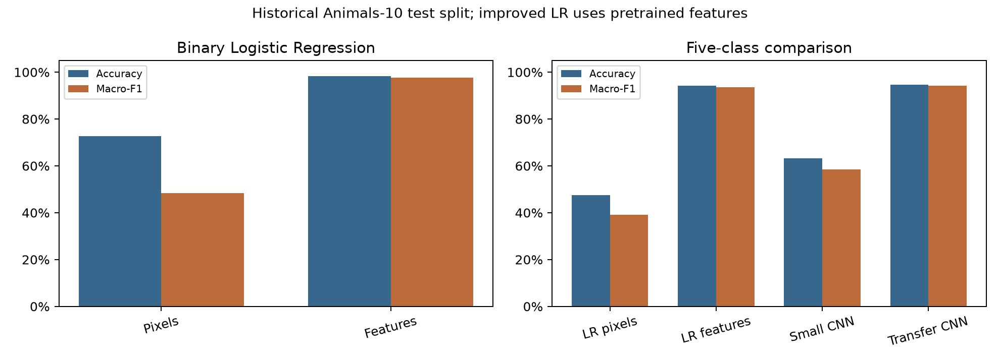
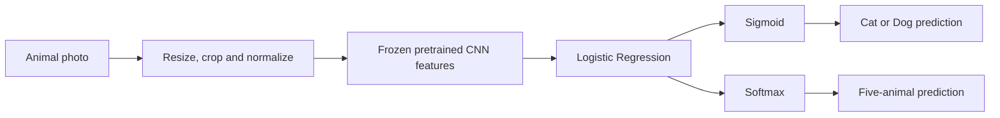

# Animal image classifier

Classify Cat, Dog, Cow, Horse and Sheep photographs with Logistic Regression. The project follows a simple sequence: prepare the data, learn binary classification with Sigmoid, extend it to five classes with Softmax, then compare against CNNs.

The original raw-pixel models are preserved. The improved models still use Logistic Regression as the final classifier, but receive image features from a frozen pretrained CNN. Those pretrained features are part of the method and explain much of the improvement.

## Why start with Logistic Regression?

Binary Logistic Regression makes the first task easy to follow: separate cats from dogs, turn a linear score into a probability with Sigmoid, and examine the mistakes. Multinomial Logistic Regression extends the same idea to five animals using Softmax. Both train quickly and give us a clear baseline before introducing CNNs.

## Results

Accuracy and macro-F1 on the **same historical Animals-10 test images**:

| Model | Previous accuracy | Improved accuracy | Previous macro-F1 | Improved macro-F1 |
| --- | ---: | ---: | ---: | ---: |
| Binary Logistic Regression | 72.73% | **98.26%** | 48.43% | **97.70%** |
| Five-class Logistic Regression | 47.48% | **94.23%** | 39.01% | **93.54%** |
| CNN comparison | 63.27% | 94.65% | 58.56% | 94.24% |

The binary task has 979 test images; the five-class tasks share 1,925. Macro-F1 averages the class F1 scores equally, so weak performance on smaller classes remains visible. Notebook summaries also show precision and recall as percentages.

The binary model's Cat recall rose from 8.03% to **95.98%**. It now predicts Dog for 74.87% of test images, close to the actual 74.57%, compared with 94.08% previously. Five-class Dog predictions fell from 55.06% to 38.03%, close to the actual 37.92%.



### A separate external check

The historical test results were already inspected before this improvement study. They are useful for comparison, but they are not an untouched final assessment.

After fixing the models, we also evaluated a separately collected iNaturalist sample with observation dates in 2025 to 2026. Selection used photo licenses, source IDs and duplicate checks, without model predictions. Visual review excluded 14 observations showing only bones, teeth, tracks or dung, before inference. Difficult animal photographs were retained, and excluded observations were not replaced.

| Model | External animal photos | Accuracy | Macro-F1 |
| --- | ---: | ---: | ---: |
| Binary Logistic Regression | 37 | **64.86%** | 64.76% |
| Five-class Logistic Regression | 86 | **58.14%** | 58.35% |
| CNN comparison | 86 | 53.49% | 52.46% |

This sample contains distant, dark and partly hidden animals. It shows that the strong Animals-10 scores do **not** establish 85%+ accuracy on arbitrary new photos. The external sample is small and not representative of every use case. Contributor dates and imperfect hashing cannot prove complete source independence from either dataset or pretraining. Results for all 100 observations, including non-animal remains, and Wilson accuracy intervals are also saved in `outputs/improved/`. No model was tuned after seeing these results.

## Data and preparation

[Animals-10 by Alessio Corrado](https://www.kaggle.com/datasets/alessiocorrado99/animals10), version 2, contains 26,179 images in ten Italian-labelled folders. We select:

| Folder | Class | Training | Validation | Test |
| --- | --- | ---: | ---: | ---: |
| `gatto` | Cat | 1,168 | 251 | 249 |
| `cane` | Dog | 3,402 | 731 | 730 |
| `mucca` | Cow | 1,305 | 280 | 280 |
| `cavallo` | Horse | 1,837 | 393 | 393 |
| `pecora` | Sheep | 1,274 | 273 | 273 |

The selected folders contain 12,840 files. Original preparation found no corrupt images or exact pixel duplicates and excluded one visually confirmed label error, leaving **12,839 images**. Perceptual hashing found 1,108 candidate related pairs. Detected connected groups stay in one split, including uncertain matches. The target 70/15/15 proportions produce 8,986 / 1,928 / 1,925 images because groups remain intact. Seed 42 and the original image IDs are unchanged in the improvement study.

Kaggle lists GPL-2.0, but the collection came from Google Images without individual photo credits. Dataset photographs and image-bearing notebook outputs are therefore kept out of Git. See the [dataset license record](outputs/dataset_license.md). The external audit uses only CC0, CC BY or CC BY-SA photographs, with source links, credits, licenses and hashes recorded in its [fixed manifest](outputs/improved/external_manifest.csv). External images also stay local.

## Why did the accuracy improve?

Raw pixels describe colour at fixed positions. An animal moving across the frame, a different background or a change in lighting can change those inputs dramatically. Resizing to a small square also removes detail. A linear classifier on these values has little help recognizing the same animal in different poses. Dog was the largest class, and the original models leaned heavily toward it; the binary model missed most cats.

Small experiments with resolution, regularization and class weights exposed that limit. Accuracy rose sharply when we changed the input. A frozen pretrained CNN converts each image into 576 visual features, and Logistic Regression learns to use them to distinguish the animals. Pretraining supplies visual knowledge learned from ImageNet; it is part of the system's complexity and prior data, even though we do not retrain the extractor.



The CNN comparison uses the same frozen backbone with a learned neural head. On the historical split it beat five-class Logistic Regression by 0.42 percentage points; on the small external sample Logistic Regression did better. Neither result establishes a universal winner. Better features helped far more than simply adding class weights, while the external accuracy drop shows how much the image source still matters.

## How the models work

- Binary Logistic Regression computes a linear score and uses Sigmoid to estimate Dog probability. The threshold is 0.5; Cat is 0 and Dog is 1.
- Multinomial Logistic Regression learns one score per animal. Softmax converts the scores into probabilities that sum to one, and the largest determines the label.
- The improved input is a 576-value feature vector from frozen ImageNet-pretrained MobileNetV3-Small. Its documented preprocessing resizes the short edge to 256, centre-crops to 224 × 224, and applies ImageNet normalization. Logistic Regression then learns the classification weights. This is **pretrained-feature Logistic Regression**, not a purely raw-pixel model.
- The CNN comparison freezes the same backbone and trains a small five-class neural head. The original CNN trained from scratch is retained.

Three stratified group folds inside the training set select C from 0.01, 0.1 and 1, with or without balanced class weights. StandardScaler is inside the Pipeline, so each fold fits scaling only on its training images. Both feature classifiers selected C = 0.01 without class weighting by CV macro-F1. Validation is reported separately; no test score selected settings.

A small raw-pixel experiment also compared balanced class weights, 24/32-pixel inputs and two regularization strengths. Weighting improved macro-F1 but lowered accuracy: the selected binary model scored 60.88% accuracy / 55.65% macro-F1, and the five-class model scored 39.84% / 39.40%. It did not solve the weak representation. All candidates and CV evidence remain in supporting outputs.

The CNN head uses training-only crop/flip augmentation, inverse-frequency class weights and Adam. Validation loss chooses a checkpoint within eight epochs, with patience three. Its backbone was not fine-tuned. Training curves and full epoch records are saved.

## Setup

Tested on an Apple M3 MacBook Air with 8 GB RAM and **Python 3.12.13**. Use Python 3.12. CPU inference works; training uses Apple MPS when available. Reserve about 3 GB for dependencies, data and generated files. No paid service or AI API key is needed.

```bash
cd "$HOME/Desktop/animal classifier"
python3.12 -m venv .venv
source .venv/bin/activate
python -m pip install -r requirements.txt
```

If `.venv` already exists, activate it instead of recreating it. A fresh clone uses the same commands from its own folder.

| Library | Purpose |
| --- | --- |
| Pillow, torchvision | Read images and apply the correct transforms |
| NumPy, pandas | Store features, labels, splits and result tables |
| Matplotlib | Plot distributions, curves, confusion matrices and predictions |
| scikit-learn | Logistic Regression, Pipelines, group CV and metrics |
| PyTorch | Frozen feature extraction and CNN training |
| ImageHash | Identify candidate related images |
| SciPy, joblib | Sigmoid/Softmax calculations and saved classifiers |
| Kaggle, requests | Download the original data and fixed external images |
| Jupyter, nbclient | Read and execute notebooks |

## Run the web app

The saved models are included. The app needs neither the training dataset nor a new pretrained-weight download. For the app alone, create and activate a Python 3.12 virtual environment as above, then install the smaller production requirements:

```bash
python -m pip install -r web/requirements.txt
python -m streamlit run web/app.py
```

Open the local address shown by Streamlit. Upload a JPG, PNG or WEBP photo, take a camera photo, or swipe through ten licensed examples. Five-class Logistic Regression is the default; Cat and Dog mode uses the binary classifier. The app shows an image preview and all class probabilities. The footer credits its developer. Uploaded photos are processed in memory on the server and are not saved. Uploads are limited to 8 MB and 24 megapixels. Camera use needs browser permission and a secure context such as localhost or HTTPS.

Streamlit provides the server and supported Components v2 interface. ONNX Runtime executes an export of the unchanged frozen feature extractor on CPU; scikit-learn runs Logistic Regression. NumPy, Pillow and joblib handle preprocessing and model loading. Production does not import PyTorch, notebooks or training code. The self-hosted fonts and example photos have individual license records under `web/assets/`.

The original comparison demo remains available after installing the full research requirements:

```bash
python demo.py
python demo.py --image "/absolute/path/to/animal.jpg" --model softmax_features
```

It supports `binary_features`, `softmax_features`, `transfer_cnn`, and the original `binary`, `softmax` and `cnn`. Each uses its recorded preprocessing. Probabilities are uncalibrated estimates: an unrelated animal or object will still receive a supported label.

## Model size and deployment cost

| Saved artifact | Bytes | Size |
| --- | ---: | ---: |
| Original binary LR classifier | 46,152 | 45.07 KiB |
| Original five-class LR classifier | 72,117 | 70.43 KiB |
| Improved binary LR classifier, including scaler | 16,351 | 15.97 KiB |
| Improved five-class LR classifier, including scaler | 24,981 | 24.40 KiB |
| Frozen feature extractor, research PyTorch format | 3,830,651 | 3.65 MiB |
| Same extractor, web ONNX format | 3,717,004 | 3.54 MiB |
| Original small CNN, complete weights | 361,413 | 352.94 KiB |
| Transfer CNN, complete weights | 4,129,209 | 3.94 MiB |
| Web five-class LR pipeline: ONNX extractor + classifier + preprocessing | 3,742,557 | 3.57 MiB |
| Web package supporting both LR modes | 3,758,908 | 3.58 MiB |

KiB and MiB use powers of 1024. The five-class LR classifier takes 24.40 KiB on disk. Most of the complete 3.57 MiB pipeline comes from the CNN feature extractor. The original small CNN has smaller weights than the complete LR pipeline. The web totals exclude libraries, interface assets and the Python runtime.

A clean production environment on the M3 Mac used 444.6 MiB for installed libraries. Standalone CPU inference had a median of 7.8 ms over the ten gallery photos. Import and model loading took 33.0 seconds in the first new-environment process and 3.09 seconds in a later fresh process. Peak resident memory was about 231 MiB after those photos and 503 MiB with a synthetic 24-megapixel JPEG. Streamlit adds overhead. Cloud cold starts and capacity under simultaneous use still need measurement. Full records are in [runtime measurements](outputs/web_runtime_profile.json).

The web export preserved predicted classes for all 1,925 five-class and 979 binary historical test cases. The largest probability difference from recorded predictions was 0.0000119. Original weights and results remain unchanged. See [web checks](outputs/web_app_checks.json) and [deployment preparation](outputs/deployment_feasibility.md). Deployment to Streamlit Community Cloud is pending review.

## Reproduce the study

Download the original dataset with its official client:

```bash
mkdir -p data/raw data/processed
kaggle datasets download -d alessiocorrado99/animals10 -p data/raw --unzip
```

The public download worked without credentials during this run. If authentication is required, use `kaggle auth login`. Keep credentials outside the repository.

Read or execute the four numbered notebooks in order:

1. Explore and prepare animal images.
2. Cats vs dogs with Logistic Regression and Sigmoid.
3. Five animals with multinomial Logistic Regression and Softmax.
4. CNN comparison and evaluation.

For Jupyter:

```bash
python -m ipykernel install --prefix .venv --name animal-classifier --display-name "Animal classifier Python"
JUPYTER_PATH="$PWD/.venv/share/jupyter" python -m notebook notebooks
```

Choose the Animal classifier Python kernel. The notebooks reuse completed preparation and saved experiments by default. On a fresh data download, notebook 01 builds the processed arrays. Set `RETRAIN = True` in a model notebook only when deliberately retraining it. Detailed searches and logs are kept outside the main notebook output.

For a complete training reproduction after data preparation:

```bash
python train_improved.py --stage all
python run_notebooks.py
python assess_external.py --download --run-name reproduction
python verify.py --external-run reproduction
```

Feature extraction reuses the included frozen backbone. If that file is absent, it downloads official pretrained weights into the ignored `models/pretrained_cache/` folder. The feature cache is tied to the split-manifest hash. Use `--stage logistic` or `--stage transfer` for a specific part, and `--resume` to skip completed Logistic Regression experiments. MPS training can vary slightly between runs. The external assessor freezes model fingerprints and refuses to silently overwrite the original audit with changed models; `--run-name` records a retrained version separately, and `--external-run` verifies that named audit. Use a new name for each changed model. Reusing these external images is a reproducibility check, not a fresh independent test.

The original source and notebook version is preserved by Git tag `baseline-raw-pixels`. Original models and results keep their filenames. New experiment records are under `outputs/improved/`, including the plan, diagnostic review, candidate settings, CV scores, validation behaviour, historical predictions, external audit and verification record.

The useful `.gitattributes` rule clears outputs on Git check-in while preserving executed notebooks locally. Enable it after cloning:

```bash
git config filter.notebook-clean.clean '.venv/bin/python run_notebooks.py --strip'
git config filter.notebook-clean.required true
```

## Limitations and future work

Training-label review found clear errors and mixed-animal scenes. Candidate flags are documented without automatic relabelling or changing the frozen comparison. The pretrained extractor's centre crop can miss small or off-centre animals. The external audit demonstrates this domain gap; label quality, composition and new data need further work. The classifier cannot detect unknown animals, locate animals in a scene or guarantee confidence calibration.

The web app makes the saved LR models easier to try, but deployment cannot fix the generalization gap. More representative, independently collected photographs and a new frozen evaluation would be needed before making broader accuracy claims. Unknown-animal detection remains future work. Physical phone and Safari camera checks are still pending; desktop upload, mobile layouts, a simulated live-camera capture and the native camera-file fallback have been checked locally.

## References

- [Animals-10](https://www.kaggle.com/datasets/alessiocorrado99/animals10)
- [Official Logistic Regression documentation](https://scikit-learn.org/stable/modules/generated/sklearn.linear_model.LogisticRegression.html)
- [Stratified group cross-validation](https://scikit-learn.org/stable/modules/generated/sklearn.model_selection.StratifiedGroupKFold.html)
- [PyTorch transfer learning tutorial](https://docs.pytorch.org/tutorials/beginner/transfer_learning_tutorial.html)
- [Pretrained feature extractor and documented transforms](https://docs.pytorch.org/vision/stable/models/generated/torchvision.models.mobilenet_v3_small.html)
- [iNaturalist API](https://www.inaturalist.org/pages/api+reference) and [photo licensing](https://help.inaturalist.org/en/support/solutions/articles/151000169918-can-i-use-the-photos-and-sounds-that-are-posted-on-inaturalist-)
